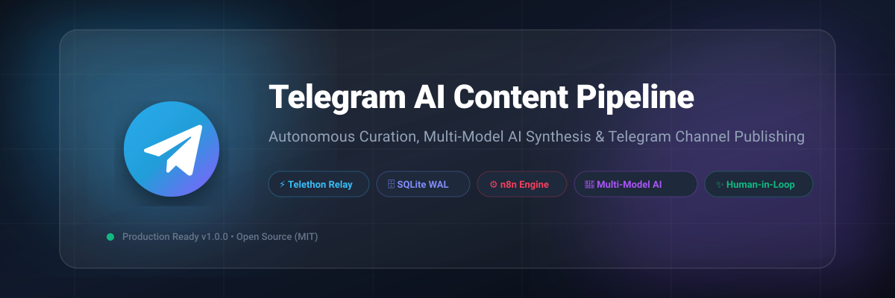
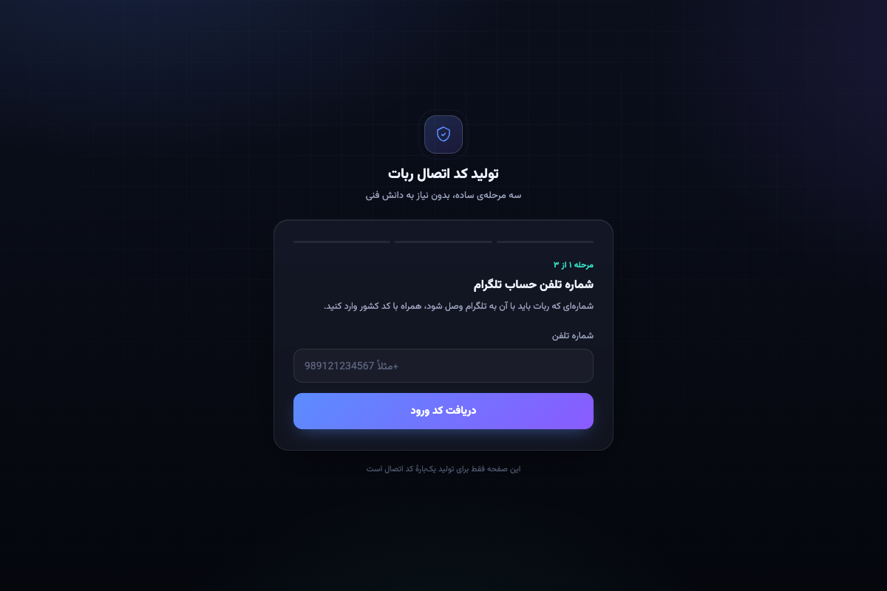
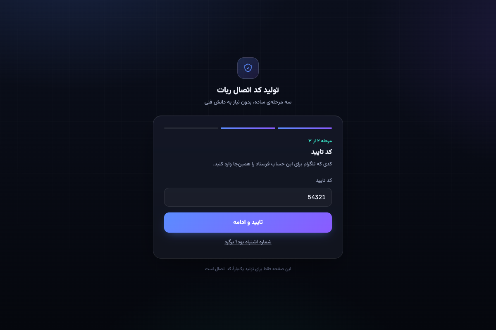
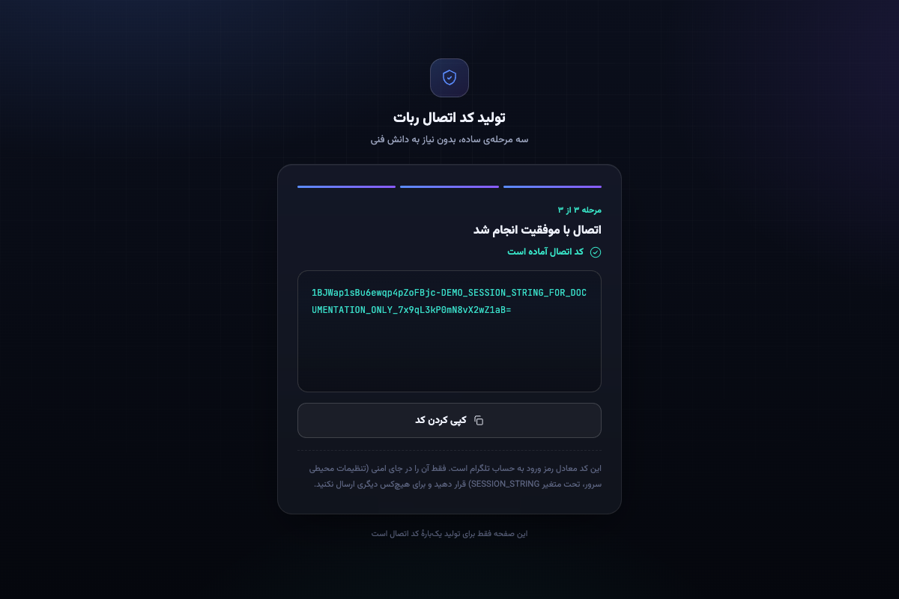

<div align="center">

  

  # Telegram AI Content Pipeline

  **Enterprise-Grade Telegram Content Aggregation, Multi-Model AI Synthesis & Channel Publishing Engine**

  [](LICENSE)
  [](https://github.com/Mahdi-Soleimani/telegram-ai-content-pipeline/actions/workflows/ci.yml)
  [](https://www.python.org/)
  [](https://github.com/LonamiWebs/Telethon)
  [](https://n8n.io/)
  [](docker-compose.yml)
  [](CONTRIBUTING.md)

  [English](README.md) • [فارسی](README.fa.md)

</div>

---

## 📑 Table of Contents

- [Overview](#-overview)
- [📸 Visual Showcase & Demo Gallery](#-visual-showcase--demo-gallery)
- [Key Features](#-key-features)
- [System Architecture](#️-system-architecture)
- [Tech Stack](#-tech-stack)
- [Folder Structure](#-folder-structure)
- [Quick Start](#-quick-start)
  - [Prerequisites](#prerequisites)
  - [1. Clone & Configure](#1-clone--configure)
  - [2. Generate Telegram StringSession](#2-generate-telegram-stringsession)
  - [3. Run with Docker Compose](#3-run-with-docker-compose)
  - [4. Run Locally (Without Docker)](#4-run-locally-without-docker)
- [n8n Workflow Setup & Import](#-n8n-workflow-setup--import)
- [Configuration Reference](#-configuration-reference)
- [Production Deployment Guide (VPS)](#-production-deployment-guide-vps)
- [⚠️ Responsible Use & Telegram Compliance](#️-responsible-use--telegram-compliance)
- [Contributing](#-contributing)
- [Security](#-security)
- [License](#-license)
- [Author](#-author)

---

## 🌟 Overview

**Telegram AI Content Pipeline** is a complete, production-hardened platform for automated content monitoring, intelligent translation/synthesis, editorial review, and broadcasting across Telegram channels and communities.

Managing active financial or news channels manually requires constant vigilance: tracking dozens of breaking sources, translating technical analysis, formatting multi-image albums, ensuring editorial accuracy, and scheduling digests. This pipeline solves that lifecycle end-to-end:

1. **Monitors** designated upstream Telegram channels via an asynchronous **Telethon Userbot**.
2. **Buffers & Persists** incoming items inside a zero-trust SQLite queue operating in Write-Ahead Logging (WAL) mode.
3. **Processes & Translates** content using a resilient dual-model AI agent architecture (**Google Gemini 2.5 Flash** with **DeepSeek V4 Flash** automatic fallback).
4. **Enforces Human-in-the-Loop Quality** through interactive Telegram inline review buttons (`Approve`, `Reject & Regenerate`, `Save to DB`).
5. **Broadcasts & Digests** approved content directly to target public channels with custom branding and media attachments.
6. **Heals & Diagnoses** runtime workflow errors automatically using a dedicated AI debugger agent.

---

## 📸 Visual Showcase & Demo Gallery

### Web Session Generator UI (Interactive 3-Step Wizard)
*Enables fast, secure Telegram authentication for headless Docker / PaaS container environments without requiring terminal stdin.*

| Step 1: Phone Authentication | Step 2: Verification Code | Step 3: Success & StringSession |
| :---: | :---: | :---: |
|  |  |  |
| *International phone input* | *OTP Telegram code entry* | *Copyable StringSession token* |

---

## ✨ Key Features

### ⚡ Resilient Telethon Relay Userbot (`account-controler`)
- **Zero-Trust Pointer Queue**: Enqueues lightweight message identifiers `(message_id, channel_id, grouped_id)` into SQLite rather than caching stale payloads.
- **Just-In-Time (JIT) Fetching**: Retrieves live message state right before dispatch; gracefully discards posts that were deleted upstream before delivery.
- **Album Settlement Buffer**: Groups multi-part albums by `grouped_id` with a settling timer to prevent fragmented media dispatch.
- **FloodWait Resilience**: When Telegram imposes rate limits, pauses **only** the dispatcher loop. Ingestion continues to listen and buffer new posts without missing events.
- **Anti-Ban Jitter**: Implements randomized delivery delays (`1.5s - 4.5s`) to mimic human operator cadence.
- **Dead Letter Queue (DLQ)**: Retries failed dispatches up to bounded limits before parking broken rows into a `failed` state.
- **Cloud Orchestrator Healthcheck**: Exposes a built-in lightweight HTTP liveness responder on port `8080`.

### 🔑 Headless Web Session Generator (`session-generator-service`)
- **PaaS Authentication Problem Solved**: Deploying Telethon on container platforms (Docker, Render, Railway, K8s) is notoriously difficult because containers lack `stdin` for interactive terminal logins.
- **Modern Persian RTL Interface**: Built with sleek typography (`Vazirmatn`, `JetBrains Mono`), dark mode glassmorphism, animated step indicators, and copy-to-clipboard functionality.
- **3-Step Authentication Wizard**:
  1. International phone number validation (`+98...`).
  2. Telegram OTP login code entry with resend capability.
  3. Seamless 2FA Cloud Password handling.
- **Thread-Affinity & Memory Hygiene**: Runs under `waitress` with strict single-thread isolation and automated in-memory session expiration (`SESSION_TTL_MINUTES`).

### 🧠 Multi-Model AI Synthesis Engine (`n8n-bot`)
- **Dual-Model LLM Architecture**: Primary synthesis via **Google Gemini 2.5 Flash**, with zero-downtime automatic fallback to **DeepSeek V4 Flash**.
- **High-Density Journalistic Prompts**: Retains core facts and technical metrics while removing clickbait, hyperbole, and fluff.
- **Market Overview Extractor**: Automatically parses crypto indicators, support/resistance levels, and numerical price metrics.
- **Clean Formatting Engine**: Regex sanitizers strip ugly markdown artifacts and append standardized channel signatures.
- **Comprehensive Media Pipeline**: Native support for text, photos, videos, audio tracks, voice notes, documents, GIF animations, and full multi-media albums.

### 🛡️ Human-in-the-Loop & Autonomous Operations
- **Interactive Review Flow**: Drafted posts are delivered to an admin review chat with inline buttons:
  - `✅ Approve`: Publishes immediately to the target channel and updates the draft with a confirmation badge.
  - `🔄 Reject & Regenerate`: Instructs the AI agent to produce an alternative rewrite.
  - `💾 Save to Database`: Persists records into an n8n Data Table for scheduled digest compilation.
- **Scheduled Digest Broadcaster**: Built-in cron scheduler that aggregates stored news items into a unified market recap accompanied by video media.
- **Self-Healing AI Error Alerting**: Captures pipeline exceptions, prompts an AI debugger agent (Gemini Flash Lite), and sends a concise 1-sentence diagnostic alert in Persian to administrators.

---

## 🏗️ System Architecture

```mermaid
flowchart TD
    subgraph Sources["📡 Source Channels"]
        S1["Telegram Crypto Channels"]
        S2["Financial News & Signals"]
    end

    subgraph Userbot["⚡ Relay Userbot (Telethon)"]
        Ingest["Ingestion Listener<br/>(events.NewMessage)"]
        Queue[("SQLite Queue (WAL)<br/>relay_queue.db")]
        Dispatch["Dispatcher Service<br/>(JIT Fetcher + Anti-Ban Jitter)"]
        Ingest -->|"message_id, channel_id"| Queue
        Queue -->|"Due messages"| Dispatch
    end

    subgraph Auth["🔑 Session Tool"]
        WebUI["Session Generator Web UI<br/>(Flask + Waitress)"]
        TeleClient["Telethon StringSession Client"]
        WebUI <--> TeleClient
        TeleClient -.->|"Export SESSION_STRING"| Userbot
    end

    subgraph Pipeline["⚙️ n8n AI Workflow Pipeline"]
        TgIn["Telegram Webhook Receiver"]
        Router["Channel Filter & Media Categorizer"]
        AIAgent["Multi-Model AI Agent<br/>(Gemini 2.5 Flash / DeepSeek Fallback)"]
        Sanitize["Markdown Regex Sanitizer"]
        ReviewChat["Admin Review Chat<br/>(Interactive Inline Buttons)"]
        DataTable[("n8n Internal Data Table")]
        Scheduler["Scheduled Digest Cron"]
        ErrorHandler["AI Debugger Alerting Agent"]

        TgIn --> Router
        Router --> AIAgent
        AIAgent --> Sanitize
        Sanitize --> ReviewChat
        ReviewChat -->|"💾 Save"| DataTable
        Scheduler -->|"Aggregate Batch"| DataTable
        Pipeline -.->|"On Failure"| ErrorHandler
    end

    subgraph Broadcast["📢 Distribution"]
        Channel["Official Public Telegram Channel"]
    end

    S1 & S2 -->|"MTProto Stream"| Ingest
    Dispatch -->|"Relay / Forward"| TgIn
    ReviewChat -->|"✅ Approve"| Channel
    Scheduler -->|"Broadcast Digest"| Channel
    ErrorHandler -->|"Diagnostic Alert"| ReviewChat
```

---

## 🧰 Tech Stack

| Layer | Technology | Purpose |
| :--- | :--- | :--- |
| **Relay Engine** | Python 3.11+ / [Telethon](https://github.com/LonamiWebs/Telethon) | High-performance asynchronous MTProto Telegram client |
| **Queue & Persistence** | [aiosqlite](https://github.com/omnilib/aiosqlite) / SQLite3 (WAL Mode) | Non-blocking transactional queue with crash resilience |
| **Session Web UI** | Flask 3.0 / Waitress 3.0 | Single-threaded WSGI server for thread-safe Telegram logins |
| **Workflow Engine** | [n8n](https://n8n.io/) (v1.x+) | Node-based event automation and webhook orchestration |
| **AI / LLM Framework** | `@n8n/n8n-nodes-langchain` | Multi-agent orchestration and fallback routing |
| **AI Models** | Google Gemini 2.5 Flash / DeepSeek V4 | News summarization, translation, and error diagnosis |
| **Containerization** | Docker / Docker Compose | Multi-stage unprivileged non-root container deployment |
| **Security Auditing** | [Gitleaks](https://github.com/gitleaks/gitleaks) / GitHub Actions | Zero-secrets CI enforcement and automated security scanning |

---

## 📁 Folder Structure

```
telegram-ai-content-pipeline/
├── .github/
│   ├── ISSUE_TEMPLATE/
│   │   ├── bug_report.md
│   │   └── feature_request.md
│   ├── workflows/
│   │   └── ci.yml                 # Automated syntax, linting & secret scanning
│   ├── dependabot.yml
│   └── PULL_REQUEST_TEMPLATE.md
├── account-controler/              # Telegram Relay Userbot service
│   ├── Dockerfile                 # Multi-stage, unprivileged non-root container
│   ├── .dockerignore
│   ├── .env.example               # Safe configuration template
│   ├── main.py                    # Ingestion, persistence & JIT dispatch logic
│   └── requirements.txt
├── session-generator-service/     # Web-based StringSession authentication tool
│   ├── Dockerfile
│   ├── .dockerignore
│   ├── .env.example
│   ├── app.py                     # Flask backend & Telethon login handler
│   ├── main.py                    # Waitress production WSGI entrypoint
│   ├── requirements.txt
│   ├── static/                    # Frontend styling (CSS) & logic (JS)
│   └── templates/                 # RTL Persian login wizard (index.html)
├── n8n-bot/
│   └── workflows/                 # Sanitized public n8n workflow definitions
│       ├── telegram-ai-content-pipeline.json
│       └── error-handling.json
├── assets/
│   └── banner.svg                 # High-resolution vector banner
├── .dockerignore
├── .editorconfig
├── .env.example                   # Master environment template
├── .gitignore                     # Comprehensive Git exclusion rules
├── CHANGELOG.md
├── CODE_OF_CONDUCT.md
├── CONTRIBUTING.md
├── docker-compose.yml             # Full-stack container orchestration
├── LICENSE                        # MIT License
├── README.md                      # English documentation (this file)
├── README.fa.md                   # Persian documentation
└── SECURITY.md                    # Responsible disclosure guidelines
```

---

## 🚀 Quick Start

### Prerequisites
- [Docker](https://docs.docker.com/get-docker/) & [Docker Compose](https://docs.docker.com/compose/) installed.
- Telegram API credentials (`API_ID` and `API_HASH`) from [my.telegram.org](https://my.telegram.org).
- A Telegram Bot Token from [@BotFather](https://t.me/BotFather).
- An LLM API key (Google Gemini or OpenAI-compatible endpoint).

### 1. Clone & Configure
```bash
git clone https://github.com/Mahdi-Soleimani/telegram-ai-content-pipeline.git
cd telegram-ai-content-pipeline

# Copy configuration template
cp .env.example .env
```

Open `.env` and fill in your parameters:
```ini
API_ID=12345678
API_HASH=your_api_hash_here
TELEGRAM_BOT_TOKEN=123456789:ABCdefGhIJKlmNoPQRsTUVwxyZ
TELEGRAM_ADMIN_CHAT_ID=123456789
TARGET_CHANNEL_ID=-1001234567890
OPENAI_API_KEY=your_gemini_or_openai_api_key
SOURCE_CHANNELS=@source_channel_1,@source_channel_2
TARGET_CHAT=@your_intake_bot
```

### 2. Generate Telegram StringSession
Before launching the userbot, you need a one-time `SESSION_STRING`:

```bash
# Start the session generator service
docker compose up -d session-generator
```

<div align="center">
  
  <p><em>Interactive RTL Web Interface for Generating Telethon StringSession (Port 5000)</em></p>
</div>

1. Open your browser at `http://localhost:5000`.
2. Enter your Telegram phone number with international format (e.g. `+98912...`).
3. Enter the login code Telegram sent to your account (and 2FA password if enabled).
4. Copy the generated `SESSION_STRING` into your `.env` file under `SESSION_STRING=...`.
5. Stop the session generator container once finished:
   ```bash
   docker compose stop session-generator
   ```

### 3. Run with Docker Compose
Launch the complete stack (Relay Userbot + n8n):
```bash
docker compose up -d relay-userbot n8n
```

- **Userbot Status**: Check logs with `docker compose logs -f relay-userbot`.
- **n8n Dashboard**: Open `http://localhost:5678` to import workflows.

### 4. Run Locally (Without Docker)

#### Relay Userbot:
```bash
cd account-controler
python3 -m venv venv
source venv/bin/activate
pip install -r requirements.txt
cp .env.example .env   # Configure API_ID, API_HASH, SESSION_STRING
python3 main.py
```

#### Session Generator:
```bash
cd session-generator-service
python3 -m venv venv
source venv/bin/activate
pip install -r requirements.txt
cp .env.example .env   # Configure API_ID, API_HASH
python3 main.py
```

---

## ⚙️ n8n Workflow Setup & Import

1. Access your n8n instance at `http://localhost:5678`.
2. Ensure environment variable access in nodes is enabled in n8n (already configured in `docker-compose.yml` via `N8N_BLOCK_ENV_ACCESS_IN_NODE=false`).
3. Click **Workflows** → **Import from File...**:
   - Import `n8n-bot/workflows/telegram-ai-content-pipeline.json`
   - Import `n8n-bot/workflows/error-handling.json`
4. Set up credentials inside n8n:
   - **Telegram API**: Link your Telegram Bot Token.
   - **OpenAI / Gemini Chat Model**: Link your LLM API Key (Base URL for Gemini: `https://generativelanguage.googleapis.com/v1beta/openai/`).
5. Activate both workflows.

---

## ⚙️ Configuration Reference

### Master Environment Variables

| Variable | Description | Required | Default / Example |
| :--- | :--- | :---: | :--- |
| `API_ID` | Telegram MTProto API App ID | **Yes** | `12345678` |
| `API_HASH` | Telegram MTProto API App Hash | **Yes** | `0123456789abcdef0123456789abcdef` |
| `SESSION_STRING` | Base64 Telethon string session | **Yes** | `1BJWap...placeholder...=` |
| `SOURCE_CHANNELS`| Upstream channels to monitor (comma-separated) | **Yes** | `@channel_a,@channel_b` |
| `TARGET_CHAT` | Relay destination (intake bot or staging chat) | **Yes** | `@intake_bot` |
| `TELEGRAM_BOT_TOKEN` | Token for the intake/review bot | **Yes** | `123456789:ABCdef...` |
| `TELEGRAM_ADMIN_CHAT_ID` | Telegram user ID for admin review & alerts | **Yes** | `123456789` |
| `TARGET_CHANNEL_ID` | Public broadcast channel ID | **Yes** | `-1001234567890` |
| `OPENAI_API_KEY` | LLM API Key for Gemini / OpenAI / DeepSeek | **Yes** | `sk-...` |
| `RELAY_MODE` | Delivery mode (`copy` or `forward`) | No | `copy` |
| `DELAY_MINUTES` | Dispatch delay in minutes | No | `0` |
| `DB_PATH` | Path to persistent SQLite database | No | `/app/data/relay_queue.db` |
| `POLL_INTERVAL_SECONDS` | Queue poller check frequency | No | `5` |
| `ALBUM_WAIT_SECONDS` | Settlement window for multi-part albums | No | `5` |
| `SEND_DELAY_MIN_SECONDS` | Minimum human-emulation jitter delay | No | `1.5` |
| `SEND_DELAY_MAX_SECONDS` | Maximum human-emulation jitter delay | No | `4.5` |
| `JOURNAL_MODE` | SQLite journal mode | No | `WAL` |
| `N8N_PORT` | Port for the n8n automation dashboard | No | `5678` |
| `SESSION_GEN_PORT`| Port for the session generator web tool | No | `5000` |

---

## 🌐 Production Deployment Guide (VPS)

### 1. Server Hardening & Docker Setup
```bash
# Update Ubuntu packages
sudo apt update && sudo apt upgrade -y
sudo apt install -y curl ufw git ca-certificates

# Install Docker
curl -fsSL https://get.docker.com -o get-docker.sh
sudo sh get-docker.sh
sudo usermod -aG docker $USER

# Setup Firewall
sudo ufw default deny incoming
sudo ufw default allow outgoing
sudo ufw allow ssh
sudo ufw allow 80/tcp
sudo ufw allow 443/tcp
sudo ufw enable
```

### 2. Reverse Proxy with Caddy (Automatic Free SSL)
Create `/etc/caddy/Caddyfile`:
```caddy
n8n.yourdomain.com {
    reverse_proxy 127.0.0.1:5678
}
```

Reload Caddy:
```bash
sudo systemctl reload caddy
```

### 3. Service Persistence & Automated Restarts
All services in `docker-compose.yml` include `restart: unless-stopped` and persistent named volumes (`userbot_data`, `n8n_data`). Your message queue and n8n database survive reboots and container upgrades.

---

## ⚠️ Responsible Use & Telegram Compliance

> [!WARNING]
> Running automated Telegram Userbots involves specific responsibilities and risks:

1. **Telegram Terms of Service**: Automating user accounts is subject to the [Telegram Terms of Service](https://telegram.org/tos). Excessive request rates or spamming can trigger account restrictions (`SpamBot` bans).
2. **Rate Limiting & Anti-Ban Best Practices**:
   - Always maintain reasonable jitter delays (`SEND_DELAY_MIN_SECONDS=1.5` or higher).
   - Never relay dozens of messages per second to the same destination.
   - Do not join hundreds of public channels simultaneously on a newly created account.
3. **Intellectual Property & Content Attribution**:
   - When curating and translating content from third-party analysts or news outlets, ensure you respect source attribution, copyright, and fair-use guidelines.
   - The included workflow templates support dynamic source citation tags.

---

## 🧪 Testing

Run code quality and syntax tests locally:
```bash
# Test Python syntax
flake8 . --count --select=E9,F63,F7,F82 --show-source --statistics

# Validate workflow JSON structures
python3 -c "
import json, glob
for path in glob.glob('n8n-bot/workflows/*.json'):
    with open(path) as f:
        json.load(f)
    print(f'Valid JSON: {path}')
"

# Audit repository for secrets
gitleaks dir . --verbose
```

---

## 🤝 Contributing

Contributions are warmly welcomed! Please read [CONTRIBUTING.md](CONTRIBUTING.md) and review [CODE_OF_CONDUCT.md](CODE_OF_CONDUCT.md) before submitting pull requests.

1. Fork the project.
2. Create your feature branch (`git checkout -b feat/amazing-feature`).
3. Commit your changes (`git commit -m 'feat: add amazing feature'`).
4. Push to the branch (`git push origin feat/amazing-feature`).
5. Open a Pull Request.

---

## 🔐 Security

Security vulnerabilities are taken very seriously. Please review [SECURITY.md](SECURITY.md) for details on how to report security issues privately. **Never expose or commit `.env` files, string sessions, or bot tokens.**

---

## 📄 License

Distributed under the **MIT License**. See [`LICENSE`](LICENSE) for complete details.

---

## 🙏 Author

- **Mahdi Soleimani** — [GitHub Profile (@Mahdi-Soleimani)](https://github.com/Mahdi-Soleimani)
